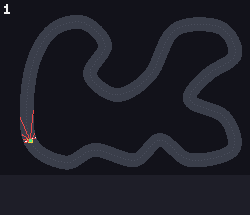
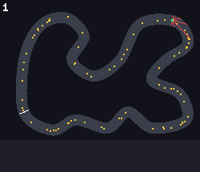
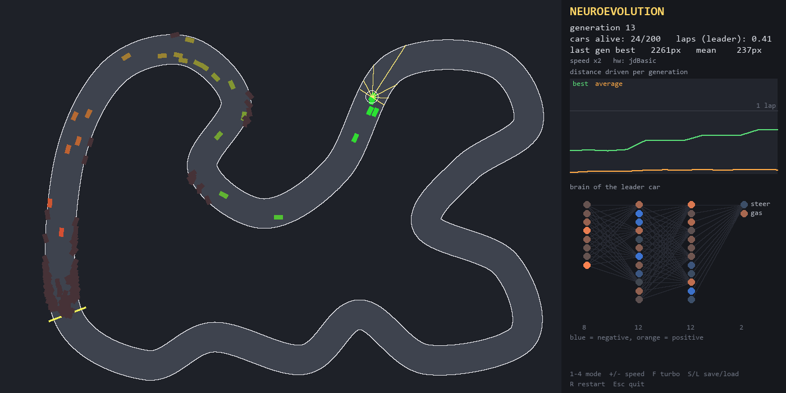
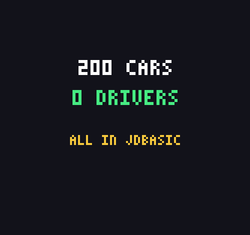
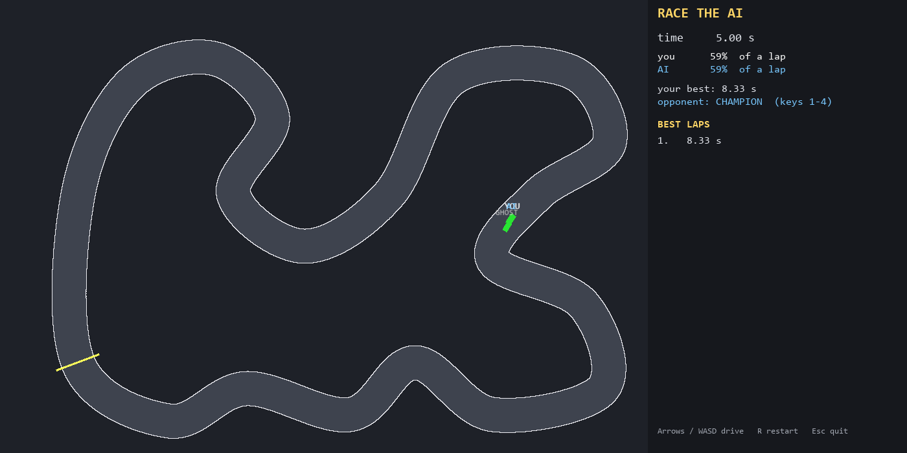

# 🏎️ RL Autonomous Racing, in jdBasic

A port of [RL-autonomous-racing](https://github.com/AmineChr54/RL-autonomous-racing) (Python: numpy + PyTorch + pygame) to **jdBasic**. A swarm of 200 cars, each with a tiny neural network as its brain, learns to lap a winding track. The same environment is solved with four learning algorithms: neuroevolution, REINFORCE, DQN and PPO.

jdBasic has no autodiff and no deep-learning library, so this repo also contains **`torch.jdb`, a small PyTorch written in plain jdBasic**: a tape-based reverse-mode autograd, MLPs, Adam and gradient clipping, checked against finite differences.

The port has three goals:

1. **Rewrite the project in jdBasic** with the same file layout, constants and behaviour as the Python original, so the two can be compared side by side.
2. **Find out what jdBasic is missing** for this kind of numeric work, and how much each gap costs. This is in [COMPARISON.md](COMPARISON.md).
3. **Run it both ways**: interpreted (`jdBasic main.jdb`) and compiled to a native `.exe` (`jdBasic -c main.jdb`).

> **Status:** all four learners, the window, the playable mode, the benchmarks, the learning curves and the pitch video work, interpreted and compiled. Open: DQN speed (#46), parallel training for DQN (#54), the OpenGL view (#55, needs a jdBasic build with GL), re-testing everything on the new jdBasic release. See the [issues](../../issues).

## What is in here

| File | Ports | What it does | Status |
|---|---|---|---|
| `track.jdb` | `track.py` | Closed Catmull-Rom spline, uniform resample, road mask and nearest-centerline index map as flat arrays | ✅ identical to Python (171 870 road pixels, 3 186 px lap) |
| `env.jdb` | `env.py` | 200 cars: physics, 7 ray sensors, crash/stuck/timeout, progress reward | ✅ parity with Python, max diff 5e-10 |
| `torch.jdb` | (PyTorch) | Tape autograd with 20 ops, MLP, Adam, `clip_grad_norm`, polyak, JSON save/load | ✅ gradcheck passes interpreted and native |
| `brain.jdb` | `brain.py` | 290-number genomes, every car runs its own net, batched without `bmm` | ✅ identical to `forward_numpy` (2e-16) |
| `evolution.jdb` | `evolution.py` | Elites, crossover, mutation | ✅ interpreter and native, 8 seeds reach half a lap at generation 24.8 on average |
| `rl_common.jdb`, `reinforce.jdb` | `rl_common.py`, `reinforce.py` | Shared rollout plumbing, REINFORCE on `torch.jdb` (tape in the interpreter, leak-free scalar loops under `-c`) | ✅ learns: mean passes half a lap at iteration 38 |
| `ppo.jdb` | `ppo.py` | PPO: GAE, clipped objective, critic (tape in the interpreter, leak-free scalar loops under `-c`) | ✅ learns: mean passes half a lap at iteration 11, 5613 px mean after 50 |
| `dqn.jdb` | `dqn.py` | DQN: replay buffer, target net, tape in the interpreter, scalar loops under `-c` | ✅ runs, gradients match; about 45 s/iteration, no half lap after 15 iterations (#46) |
| `trainer.jdb`, `main.jdb` | `make_trainer`, `main.py` | Mode dispatch; headless mode and the 1400x700 GFX window (`gui.jdb`) with the same flags | ✅ headless + GUI work interpreted and native, all four modes; `--shot` / `--record` (PNG frames) |
| `lib/gif.jdb`, `record.jdb` | (new) | Animated-GIF writer (GIF89a, LZW, quantiser; upstream candidate) and the recorder that films real training runs | ✅ the four GIFs above |
| `plot_curves.jdb`, `bench.jdb` | `plot_curves.py`, `accel.py` | Learning-curve chart (SVG), timings interpreted vs native | ✅ `assets/curves.svg`, `bench.jdb` timings in STATUS.md |
| `playable.jdb`, `train_brain.jdb` | (new) | Race the best evolved brain yourself: lap timer, best-lap table, ghost of your best lap | ✅ verified with an autopilot run; keyboard play untested |
| `pitch.jdb` | (new) | The pitch GIF composed from the four recordings, with title and numbers cards | ✅ `docs/gifs/pitch.gif` |
| `par_seeds.jdb` | (new) | Train many seeds at once on threads; the seed-variance tables in COMPARISON.md come from it | ✅ evolution, REINFORCE, PPO (staggered starts) |

## The engine live

Recorded from real training runs by `record.jdb` (jdBasic, compiled with `-c`, 80-120 cars on the hard track, seed 0). Yellow = cars, green = the current leader with its 7 rays (red), the strip underneath is best (green) and mean (blue) distance travelled per iteration so far, the number is the iteration being filmed. Each GIF is a few iterations of one run: early ones first, the last one at the end.

| | |
|---|---|
|  |  |
| Neuroevolution, 120 cars: generations 1, 5, 10 and 20 of one run, a frame every 15 ticks. | REINFORCE, 80 cars: iterations 1, 10, 20 and 30, a frame every 4 ticks (128 ticks per iteration). |
|  |  |
| PPO, 80 cars: iterations 1, 6 and 12, a frame every 4 ticks. | DQN, 80 cars: iterations 1, 4 and 8, a frame every 4 ticks (only 8 iterations at about 75 s each, so it has barely started to learn; see #46). |

Reproduce one: `JD_MEM=1500 tools/jd.sh native record.jdb reinforce 30 1,10,20,last 80 4` writes `docs/gifs/reinforce.gif` (about 80 s). The GIFs are written by `lib/gif.jdb` (`GIF.WRITE(path$, frames, delay_ms)`: GIF89a, LZW, palette quantiser; selftest `tools/jd.sh run|native tests/gif_selftest.jdb`).

## How it works

### The world

* **Track:** a closed loop through 13 (easy) or 20 (hard) control points, pre-rendered into a road mask and a "how far along the track am I?" map. Both are flat 1-D arrays indexed `y * 1000 + x`.
* **Simulation:** every tick each car picks `steer` and `throttle` in [-1, 1]. Speed has drag, and turning depends on speed. State is rounded to float32 (`CSNG`) like the numpy original, so both versions drive bit-for-bit alike.
* **Sensors:** 7 distance rays (-90° … +90°, 120 px) plus the car's speed: 8 numbers.
* **Episode end:** off the road, stuck for 70 ticks, or the time limit (900 ticks).
* **Reward:** `0.1 * pixels gained along the track - 5 if crashed or stuck`.

### `torch.jdb`: a mini PyTorch

```basic
IMPORT TORCH
DIM gen AS INTEGER = RNG.NEW(0)
DIM net AS MAP = TORCH.MLP_NEW([8, 32, 32, 2], gen)        ' Linear+Tanh stack, torch's default init
DIM opt AS MAP = TORCH.ADAM_NEW(TORCH.MLP_PIDS(net), 0.001)
TORCH.RESET()                                               ' start a new tape
DIM pred AS INTEGER = TORCH.MLP_FWD(net, TORCH.C(obs))      ' nodes are integer ids on the tape
DIM loss AS INTEGER = TORCH.TMEAN(TORCH.SQUARE(TORCH.MINUS(pred, TORCH.C(target))))
TORCH.ZERO_GRAD(TORCH.MLP_PIDS(net))
TORCH.BACKWARD(loss)
TORCH.ADAM_STEP(opt)
```

Every tensor is 2-D. The heavy maths runs on jdBasic's C++ array builtins (`MATMUL` is Eigen; `TANH` and `EXP` are vectorised). The ops: `MM`, `ADDROW`, `MULROW`, `BCASTROW`, `ADD`, `MINUS`, `MUL`, `SCALE`, `ADDS`, `TTANH`, `TEXP`, `SQUARE`, `TMEAN`, `TSUM`, `ROWSUM`, `MINIMUM`, `TCLAMP`, `GATHERCOL`, `SMOOTH_L1`, plus `NORMAL_LOGP` for Gaussian policies.

### Brains without a batched matmul

Neuroevolution gives every car its own network. Python evaluates all 200 at once with `torch.baddbmm`. jdBasic has no 3-D matmul, so `brain.jdb` does each layer with three ordinary 2-D `MATMUL`s, still for the whole swarm at once. It expands the inputs, multiplies element-wise by each car's weights, then sums per output.

## Documentation

| Doc | What |
|---|---|
| [docs/ARCHITECTURE.md](docs/ARCHITECTURE.md) | module map, the two backends, tests, parallelism and GPU notes |
| [COMPARISON.md](COMPARISON.md) | Python vs jdBasic: lines, timings, learning results, bugs, wishlist |
| [STATUS.md](STATUS.md) | state of every component, bench numbers, jdBasic bug list |
| [docs/LIBRARY_AUDIT.md](docs/LIBRARY_AUDIT.md) | which jdBasic library modules are worth using |
| [docs/PITCH.md](docs/PITCH.md) | storyboard of the pitch video |
| `assets/curves.svg` | learning curves of the four methods |

## Quick start

Needs jdBasic v1.1 Build 102 or newer (Windows x64; the `-c` native compiler needs MSVC Build Tools).

```bash
jdBasic tests/evo_smoke.jdb 3          # 3 generations of neuroevolution, prints progress
jdBasic -c tests/evo_smoke.jdb         # compile to tests/evo_smoke.exe
```

The planned entry point mirrors the Python one: `jdBasic main.jdb --mode ppo --track hard --headless --gens 40` (headless and the GUI window work; `--shot assets/shot.png` writes the screenshot below).



## Pitch video



Composed and encoded entirely in jdBasic: `JD_MEM=1500 tools/jd.sh run pitch.jdb` stitches the four per-method GIFs from `record.jdb` into one 2 x 2 film with a title card and a numbers card (built-in pixel font, `lib/gif.jdb` encoder).

## Play against the AI

```bash
tools/jd.sh native train_brain.jdb 25     # optional: retrain the opponent (assets/best_brain.json is committed)
tools/jd.sh run playable.jdb               # arrows / WASD to drive, R restart, Esc quit
```

You race the best evolved brain on the hard track; the first car over one lap wins and a crash ends your run. A lap takes the AI about 8 s.


## Tests

| Command | Checks |
|---|---|
| `tools/jd.sh run tests/track_check.jdb` | track build (point count, lap length, road pixels) |
| `python tests/env_parity.py [--native]` | jdBasic env against the Python `SwarmEnv`, 20 cars × 300 ticks |
| `python tests/brain_parity.py [--native]` | per-car brains against `brain.forward_numpy` |
| `tools/jd.sh run\|native tests/torch_gradcheck.jdb` | all 20 autograd ops against central finite differences |
| `tools/jd.sh run\|native tests/gif_selftest.jdb` | `lib/gif.jdb`: LZW round trip (incl. table reset), quantiser, file write |

The Python tests import the original project from `D:\Projects\RL-autonomous-racing`, or from `$PY_PROJECT`.

### Always run jdBasic under the memory cap

`tools/jd.sh run|native|build file.jdb [args]` runs jdBasic inside a Windows Job Object with a hard memory limit (`JD_MEM`, default 1024 MB) and a time limit (`JD_TIME`, default 600 s). `tools/jd.py` does the same for the Python tests. A few native-compiler bugs (below) can allocate many GB in seconds, and the cap turns that into a clean failure. The runner is `tools/capped.cs`, built by `tools/build_capped.sh` with the C# compiler that ships with Windows.

## Writing jdBasic that also compiles with `-c`

The native compiler is strict and fixes a type for every value at compile time. These rules were each found the hard way during the port:

* Declare every parameter that takes an array or map `AS ARRAY` / `AS MAP`, and give every function that returns one `AS ARRAY` / `AS MAP`. An untyped parameter is a number under `-c`.
* Put the result of a builtin that has both scalar and array forms (`CLAMP`, `ABS`, `FLOOR`, comparisons) in a local declared `DIM x AS ARRAY = ...`.
* Never `ZEROS([r, c])` / `ONES([r, c])` with many rows: their memory grows with the square of the rows under `-c`. Use `TORCH.ZEROS_RC` / `ONES_RC` (a flat array plus `RESHAPE`).
* Never grow a big string with `s$ = s$ + ...` in a loop under `-c`; append blocks to the file instead.
* No implicit broadcasting: repeat a row explicitly with `MATMUL(ONES_RC(n, 1), row)`.
* Identifiers are case-insensitive (`genome` and `GENOME` clash), and `STEP` is reserved.

The full list of jdBasic bugs and gaps, each with its workaround and measured cost, is in [COMPARISON.md](COMPARISON.md).

## Development workflow

Every feature or fix is a GitHub issue, worked on a branch and merged through a pull request once the checks pass. CI runs on a **self-hosted GitHub Actions runner in a local Docker container**, because the hosted runners have limits. The container has a hard 3 GB memory limit (`--memory 3g --memory-swap 3g`). Native (`-c`) builds are checked in CI too (Linux LLVM build) and locally with `tools/jd.sh native`.

```bash
ci/start-runner.sh   # Git Bash: builds the image, fetches a registration token via gh (never stored), starts the container
ci/stop-runner.sh    # deregisters the runner and removes the container
```
The container restarts automatically (`--restart unless-stopped`). Details are in `ci/README.md`.
The runner image builds jdBasic natively on Linux from upstream source (g++ + LLVM 18, pinned commit, no Wine), so the `jdbasic` job in `.github/workflows/ci.yml` runs the real tests in the interpreter and under `-c`; both jobs are required.

## Credits

The original Python project, its algorithms and constants: [AmineChr54/RL-autonomous-racing](https://github.com/AmineChr54/RL-autonomous-racing). MIT licensed, see `LICENSE`.
